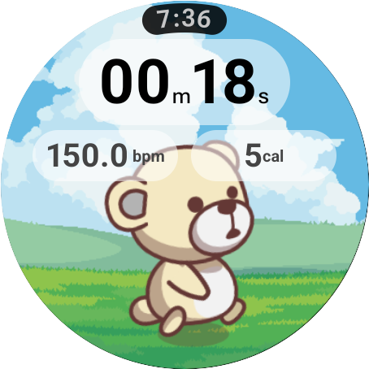
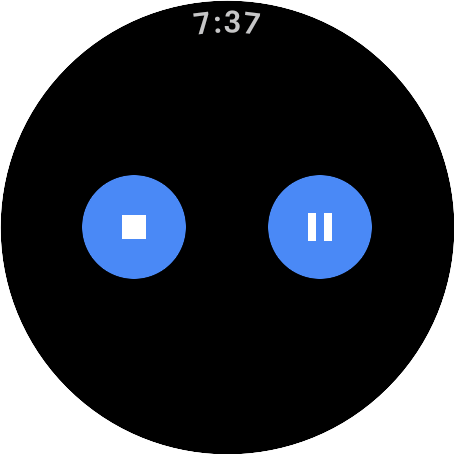
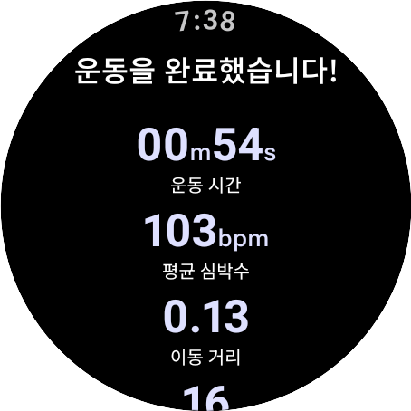
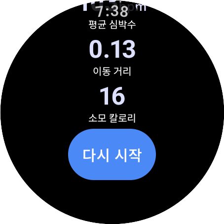

# LinkCare Watch App

Wear OS 기반 운동 트래킹 애플리케이션으로, 모바일 앱과 실시간 연동되는 헬스케어 솔루션입니다.

## 📸 스크린샷

<div align="center">

| 운동 준비 화면 | 운동 진행 화면 | 운동 제어 화면 |
|:---:|:---:|:---:|
|  |  |  |
| 권한 확인 및 시작 | 실시간 메트릭 표시 | 운동 종료/ 일시정지 버튼 |

| 운동 완료 화면 1 | 운동 완료 화면 2 |
|:---:|:---:|
|  |  |
| 운동 기록 요약 | 운동 재시작 버튼튼 |

</div>

## 🎯 주요 기능

### 1. 실시간 운동 데이터 트래킹
- **심박수, 칼로리, 거리, 운동 시간** 실시간 모니터링
- Health Services API를 활용한 정확한 센서 데이터 수집
- Foreground Service로 백그라운드에서도 안정적인 데이터 수집

### 2. 모바일 앱과 실시간 양방향 동기화
- **Wearable Data Layer API** 기반 통신
- 2초 주기 실시간 메트릭 전송
- 운동 시작/일시정지/종료 상태 즉시 동기화
- 운동 완료 후 요약 데이터 자동 전송

### 3. 커스터마이징 가능한 운동 UI
- **5가지 캐릭터** × **8가지 배경** = 40가지 조합
- 모바일에서 설정한 테마가 워치에 **즉시 반영**
- 프레임 기반 걷기 애니메이션 (운동 상태 연동)
- 운동 중/일시정지 상태에 따라 애니메이션 자동 재생/정지

### 4. Android 14+ Health Connect 지원
- 최신 Health Connect 권한 완벽 대응
- 런타임 권한 분기 처리 (API 34+)
- Google Play 정책 준수

## 🏗️ 기술 스택

### 아키텍처
- **Clean Architecture** (Presentation/Domain/Data 계층 분리)
- **MVVM Pattern** (ViewModel + StateFlow)
- **Dependency Injection** (Hilt/Dagger)

### 핵심 기술
- **Kotlin Coroutines & Flow** - 비동기 처리 및 상태 관리
- **Jetpack Compose for Wear OS** - 선언형 UI
- **Health Services API** - 센서 데이터 수집
- **Wearable Data Layer API** - 모바일 연동
- **Lifecycle-aware Components** - 메모리 누수 방지

## 📱 실행 방법

### 요구사항
- Wear OS 디바이스 또는 에뮬레이터
- Health Services 설치 필수
- Android Studio

### 실행
1. Android Studio에서 프로젝트 열기
2. Wear OS 디바이스/에뮬레이터 연결
3. 앱 실행 (Run 'app')

### 권한 설정
앱 실행 시 다음 권한이 자동으로 요청됩니다:
- 신체 센서 (심박수)
- 위치 정보
- 활동 인식
- 알림 (Android 13+)
- Health Connect 데이터 읽기 (Android 14+)

## 🔧 프로젝트 구조

```
app/src/main/java/com/a307/linkcare/
├── core/                          # 앱 초기화 및 전역 설정
│   ├── Constants.kt              # 전역 상수 정의
│   ├── MainActivity.kt           # 메인 액티비티
│   └── LinkCareExerciseApplication.kt
│
├── data/                         # 데이터 레이어
│   ├── DataLayerManager.kt      # 모바일 연동 매니저
│   ├── ExerciseClientManager.kt # 운동 센서 관리
│   ├── HealthServicesRepository.kt
│   └── model/
│       └── WorkoutSummary.kt    # 운동 요약 데이터
│
├── presentation/                 # UI 레이어
│   ├── exercise/                # 운동 화면
│   │   ├── ExerciseScreen.kt   # 메인 운동 UI (캐릭터 애니메이션)
│   │   └── ExerciseViewModel.kt
│   ├── preparing/               # 준비 화면
│   ├── summary/                 # 운동 요약 화면
│   └── component/               # 재사용 컴포넌트
│
└── service/                      # 백그라운드 서비스
    ├── ExerciseService.kt       # 운동 추적 서비스
    ├── ExerciseServiceMonitor.kt
    └── ExerciseNotificationManager.kt
```

## 🌟 핵심 구현

### 1. 실시간 데이터 전송
```kotlin
// 2초 주기로 모바일에 실시간 데이터 전송
DataLayerManager.sendMetrics(
    sessionId = currentSessionId,
    heartRate = metrics.heartRate,
    calories = metrics.calories,
    durationSec = durationSec
)
```

### 2. 테마 동기화
```kotlin
// SharedPreferences Listener로 실시간 테마 반영
DisposableEffect(Unit) {
    val listener = SharedPreferences.OnSharedPreferenceChangeListener { _, key ->
        when (key) {
            "characterId" -> characterId = prefs.getInt("characterId", 1)
            "backgroundId" -> backgroundId = prefs.getInt("backgroundId", 1)
        }
    }
    prefs.registerOnSharedPreferenceChangeListener(listener)
    onDispose { prefs.unregisterOnSharedPreferenceChangeListener(listener) }
}
```

### 3. 세션 관리
- 중복 방지 메커니즘 (플래그 + Set + ID 검증)
- 앱 재시작 시 잔여 세션 자동 정리
- 타임스탬프 초 단위 통일

## 📊 데이터 흐름

```
[Watch App] ──── Wearable Data Layer ───→ [Mobile App]
     ↓
실시간 메트릭 (2초 주기)
  - sessionId
  - heartRate
  - calories
  - durationSec
     ↓
운동 완료 후 요약
  - avgHeartRate
  - totalCalories
  - totalDistance
  - startTimestamp
  - endTimestamp

[Mobile App] ──── Wearable Data Layer ───→ [Watch App]
     ↓
테마 동기화
  - characterId
  - backgroundId
```

## 🛠️ 최근 개선 사항

### 코드 품질 개선
- ✅ 주석 처리된 코드 제거
- ✅ 로그 태그 통일 (`TAG` 상수 사용)
- ✅ 매직 넘버 상수화 (`Constants` 객체)

### 기능 업데이트
- ✅ 배경 이미지 8종 지원 (기존 2종 → 8종)
- ✅ Android 14+ Health Connect 권한 추가
- ✅ 타임스탬프 단위 통일 (초 단위)

## 🔍 주요 특징

### 성능 최적화
- `Dispatchers.Default` 사용으로 메인 스레드 보호
- `StateFlow` 캐싱으로 불필요한 재연산 방지
- `DisposableEffect`로 리스너 메모리 누수 방지

### 안정성
- Lifecycle-aware 코루틴으로 생명주기 관리
- 3중 중복 방지 메커니즘 (세션 관리)
- 에러 핸들링 및 로깅 체계

### 유지보수성
- Clean Architecture 적용
- Repository 패턴으로 비즈니스 로직 분리
- DI로 테스트 가능한 구조

## 📄 License

이 프로젝트는 SSAFY 13기 특화 프로젝트의 일부입니다.
